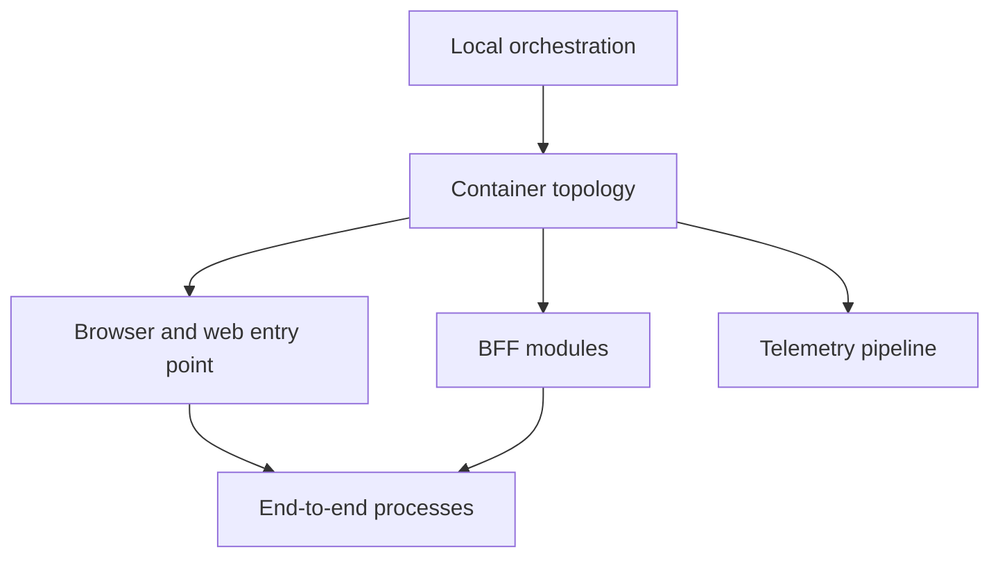

# Architecture

> Status: Reviewed against HEAD 800ac16 by a fresh reader.

The architecture tree explains the current system's boundaries, mechanisms,
and end-to-end processes. Start with the container map for runtime topology or
the process guide for a request that crosses several components.

## Architecture map

| Document                                          | Scope                                                                              |
| ------------------------------------------------- | ---------------------------------------------------------------------------------- |
| [Container topology](containers.md)               | Compose services, CLI targets, host addresses, and Kubernetes application boundary |
| [Browser and web entry point](web-entry-point.md) | Same-origin BFF and visualizer proxies, cookies, and browser routing               |
| [BFF modules](bff-modules.md)                     | Module dependencies, shared route prefixes, and domain invariants                  |
| [Observability](observability.md)                 | BFF telemetry, collector pipelines, Tempo, Prometheus, and Grafana                 |
| [Local orchestrator](orchestrator-python.md)      | `./dev` dispatch and Docker orchestration mechanisms                               |
| [End-to-end processes](processes.md)              | Checkout, visualization refresh, and performance execution across boundaries       |

## Performance engine boundary

The [Punch integration index](punch-implementation.md) describes how this
repository selects the vendored performance engine and routes readers to the
engine's own documentation. The parent repository pins Punch as a gitlink, so
internal engine behavior belongs to the pinned submodule documentation.

## Reference and decision boundaries

The [reference index](../reference/README.md) owns exhaustive HTTP,
configuration, data, integration, build, and deployment inventories. These
architecture pages explain mechanisms and consequences without repeating
those inventories.

The [ADR index](../adr/README.md) records accepted decisions. Architecture
pages describe current behavior; an ADR remains historical evidence when the
implementation later changes.

## Authoring rules

- Keep diagrams as Mermaid source in Markdown.
- Give each fact one owner and link to it elsewhere.
- Update descriptive architecture when behavior changes.
- Preserve accepted ADRs and applied migration history.
