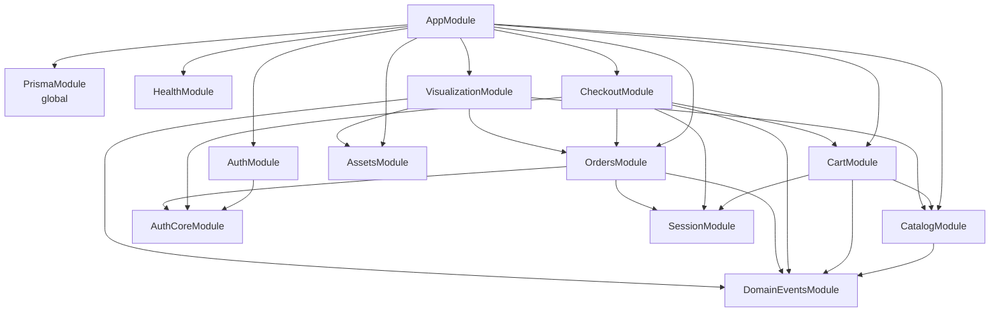

# BFF modules

> Status: Reviewed against HEAD 800ac16 by a fresh reader.

The BFF is a NestJS modular monolith. Eight feature modules own HTTP entry points and domain behavior; shared providers handle persistence, authentication, anonymous sessions, and in-process change notifications. Prisma is registered globally, while feature and core module dependencies are otherwise visible through Nest module imports and exports.

Drift anchors at HEAD 800ac16506b91b3d69ca852f9098a106e865692e: `apps/bff/src/app.module.ts`, `apps/bff/src/prisma.module.ts`, `apps/bff/src/core/`, `apps/bff/src/modules/`, `apps/bff/src/main.ts`.

## Module dependencies

The graph shows explicit `imports` relationships from each consumer to its provider. The root app composes every feature module and Prisma. `PrismaModule` is global, so modules that inject `PrismaService` do not declare a module import edge for it. Core modules are not global and consumers import them explicitly.

Edges point from consumer to provider and reflect module declarations. `CatalogModule`, `CartModule`, `CheckoutModule`, `OrdersModule`, `AssetsModule`, and `VisualizationModule` export their primary service. `AuthModule` and `HealthModule` export no providers. `AuthCoreModule`, `SessionModule`, and `DomainEventsModule` export their respective service. `PrismaModule` exports `PrismaService` and is marked `@Global()`.

## Feature ownership

Each feature module owns its controllers and application service. The services form these boundaries:

- `HealthModule` serves the BFF health check.
- `AuthModule` handles account registration, login, logout, and the current-user response. It delegates signed-in session operations to `AuthSessionService`.
- `CatalogModule` reads and creates products. It provides the product lookup used by cart and the product records used by visualization.
- `CartModule` owns cart operations for an anonymous browser session. It uses the catalog service for product identity and price, and publishes change signals.
- `CheckoutModule` coordinates the current cart and order creation. It resolves both anonymous session and optional signed-in account context, then clears the cart after a successful order.
- `OrdersModule` owns order reads, creation, account order views, and temperature status. It also publishes change signals.
- `AssetsModule` serves asset configuration and primary model references used to decorate visualization products.
- `VisualizationModule` builds visualization responses from catalog, orders, and assets. It serves both a snapshot and an SSE stream of snapshots.

The HTTP route inventory is maintained in the [HTTP API reference](../reference/http-api.md). The [data and state reference](../reference/data-and-state.md) owns the schema and exhaustive state details.

## Shared route prefixes

Controllers in separate modules share `/orders` and `/me` prefixes. Checkout owns order submission under `/orders`; Orders owns order reads and status. Auth owns the current-user endpoint under `/me`; Orders owns account order and hot-status views under the same prefix. The route reference lists the full method and path mapping.

## State ownership and caching

Postgres is the durable store for users, authentication sessions, products, assets, and orders. The global Prisma provider gives services database access; it does not imply that every read goes to the database.

Catalog, orders, and assets warm in-memory read structures during module initialization. Catalog listing and product lookup read the warmed cache; product creation writes to Postgres and appends the returned product to that cache. Orders warm the order list and session and idempotency indexes; ordinary list and item reads use those structures, while account listing and order status query Postgres directly. Asset configuration and primary model lookups use caches replaced together by an explicit refresh.

Cart state lives in a process-local map keyed by the anonymous `sid` cookie. A cart permits one item with quantity one. The one-hour reservation expires lazily when a cart is accessed, and successful checkout clears that session's cart. A BFF restart loses carts; Postgres-backed orders and other persisted records remain durable. Signing in uses a separate `auth` cookie and does not change the anonymous cart session.

`SessionModule` resolves or mints the `sid` cookie. `AuthCoreModule` resolves the signed-in user from a database-backed session represented by the `auth` cookie. Both cookies are HTTP-only, use `SameSite=Lax` and root path, and set `Secure` based on the incoming request protocol. Invalid or expired auth sessions are treated as signed out; expired rows are removed when encountered.

## Change notifications and visualization

`DomainEventsModule` provides a process-local RxJS subject that carries a coarse change signal without a payload. Catalog creation, cart addition, checkout, and order creation emit it. Cart clearing and lazy reservation expiry do not emit independently. `VisualizationController` sends a full snapshot immediately to each SSE subscriber, then rebuilds and sends a snapshot after a change signal. A 50 millisecond debounce coalesces bursts such as order creation followed by checkout completion.

The visualization snapshot aggregates catalog products and orders and decorates products with asset data. The service has no request context, so its snapshot does not contain a session-specific cart. The SSE signal is in-process: it reaches subscribers connected to the same BFF process and is not a cross-instance event transport. See the [data and state reference](../reference/data-and-state.md) for response state and persistence ownership.

## Startup behavior

Bootstrap calls telemetry initialization before creating the Nest application. When `OTEL_EXPORTER_OTLP_ENDPOINT` is set, the initializer starts the OpenTelemetry NodeSDK with an HTTP trace exporter and auto-instrumentations; without it, initialization returns immediately. This call order does not prove instrumentation coverage because application modules are statically imported before bootstrap runs.

Bootstrap then installs a strict transforming validation pipe, request logging interceptor, and HTTP exception filter globally. It configures CORS from `CORS_ORIGIN` (default `*`) and listens on `PORT` (default `3001`). Invalid auth-session TTL and order cool-down configuration fail during provider initialization rather than serving with an invalid duration.
