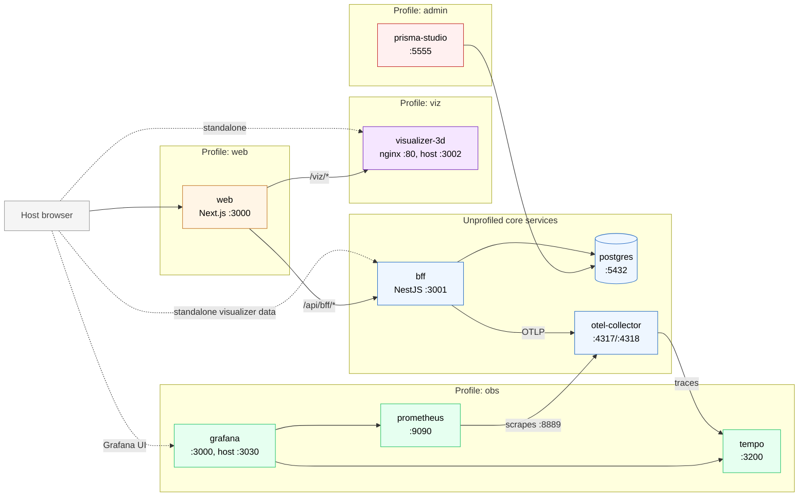

# Containers: C4 level 2

> Status: Reviewed against HEAD 800ac16 by a fresh reader.

This page owns the main Docker Compose topology and the application Kubernetes
base. Drift anchors: `infra/docker/compose.yaml`,
`infra/docker/compose.dev.yaml`, `infra/docker/compose.performance.yaml`, and
`infra/k8s/`.

## Container map

The arrows for API and asset rewrites represent server requests. The
standalone visualizer fetches BFF data in the browser; nginx serves its
static files. Embedded scene-data requests use the web app's `/api/bff`
proxy. Smoke checks and protocol k6 tests are separate direct BFF clients.

## CLI targets and Compose profiles

| CLI target       | Brings up                           | Activated by     |
| ---------------- | ----------------------------------- | ---------------- |
| `core` (default) | `postgres`, `bff`, `otel-collector` | `./dev up`       |
| `web`            | + `web`                             | `./dev up web`   |
| `viz`            | + `visualizer-3d`                   | `./dev up viz`   |
| `admin`          | + `prisma-studio`                   | `./dev up admin` |
| `obs`            | + `tempo`, `prometheus`, `grafana`  | `./dev up obs`   |
| `full`           | all of the above                    | `./dev up full`  |

The core services have no Compose profile. The `web`, `viz`, `admin`, and
`obs` targets enable their corresponding profiles; `full` enables all four.
The visualizer also accepts the legacy Compose profile name `visualizer`.

`--fresh` on any `up` target removes all base-stack named volumes, including
Postgres and observability data, before running migrations and seeding.

## Service inventory

| Service          | Tech                     | Default URL                         | Role                                                              |
| ---------------- | ------------------------ | ----------------------------------- | ----------------------------------------------------------------- |
| `web`            | Next.js 14 standalone    | http://localhost:3000               | Product shell + browser entry point                               |
| `bff`            | NestJS                   | http://localhost:3001               | Domain API                                                        |
| `visualizer-3d`  | nginx + vanilla Three.js | http://localhost:3002               | Standalone scene; embedded via `/viz` proxy                       |
| `postgres`       | Postgres 16              | localhost:5432                      | Commerce, asset, identity, and authentication-session persistence |
| `prisma-studio`  | Prisma Studio            | http://localhost:5555               | Database administration; direct writes emit no domain events      |
| `otel-collector` | otel-contrib 0.110       | localhost:4317 / 4318               | OTLP ingest, fan-out to Tempo + Prometheus exporter               |
| `tempo`          | Grafana Tempo 2.6        | http://localhost:3200               | Trace storage                                                     |
| `prometheus`     | Prometheus 2.55          | http://localhost:9090               | Metrics scrape + storage                                          |
| `grafana`        | Grafana 11.3             | http://localhost:3030 (admin/admin) | Dashboards, Tempo/Prom datasources pre-provisioned                |

## Compose files

| File                                    | Purpose                                                                                                           |
| --------------------------------------- | ----------------------------------------------------------------------------------------------------------------- |
| `infra/docker/compose.yaml`             | Base stack with all profiles                                                                                      |
| `infra/docker/compose.dev.yaml`         | Dev stages for BFF and web; sync BFF `src/`, web `app/`, and visualizer `public/`, with selected rebuild triggers |
| `infra/docker/compose.performance.yaml` | Separate k6 stack that does not alter the main stack lifecycle                                                    |

## Kubernetes (minikube)

`infra/k8s/` deploys the five application services corresponding to the
`core` + `web` + `viz` targets to minikube with Kustomize, keeping the Compose
service names. Driven by `./dev k8s:up` /
`k8s:forward` / `k8s:status` / `k8s:down`; details in
[`infra/k8s/README.md`](../../infra/k8s/README.md).

## Browser request topology

The web app serves the workspace and proxies its API and embedded visualizer
requests over the internal Docker network. Standalone visualizer access uses
a separate origin and a browser-reachable BFF base. Diagram and routing rules live in
[`web-entry-point.md`](web-entry-point.md).

## Related

- BFF components: [`bff-modules.md`](bff-modules.md)
- Observability pipeline: [`observability.md`](observability.md)
- Local orchestrator: [`orchestrator-python.md`](orchestrator-python.md)
- CLI to drive these profiles: [`../cli-reference.md`](../cli-reference.md)
