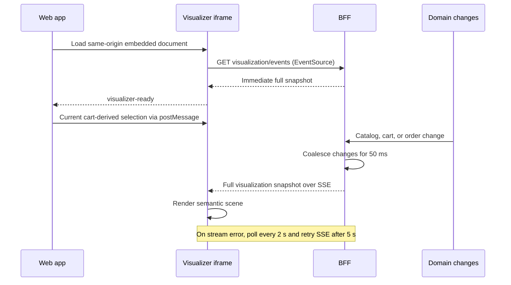
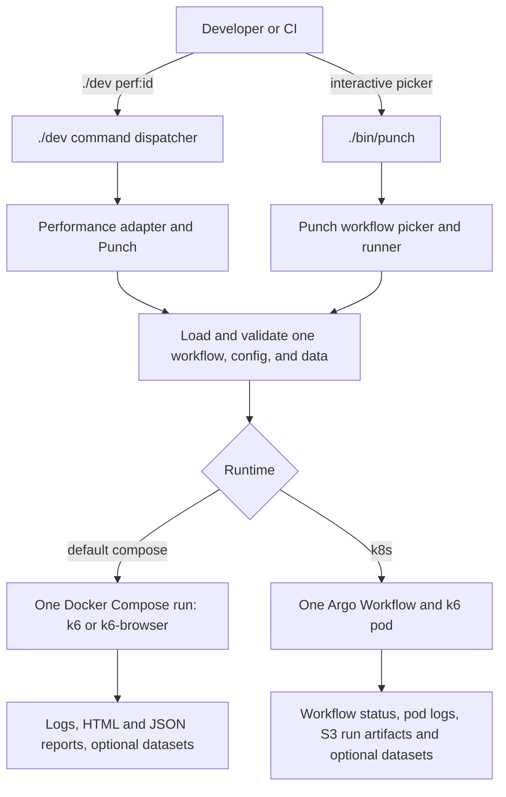

# End-to-end processes

> Status: Reviewed against HEAD 800ac16 by a fresh reader.

These three processes show where state crosses browser, service, database, and execution boundaries. They describe current behavior and call out where an error leaves work incomplete or asks the caller to recover.

Implementation anchors: `apps/web/app/page.tsx`, `apps/web/src/components/cart/CartCheckoutPanel.tsx`, `apps/web/src/components/auth/AuthProvider.tsx`, `apps/web/src/components/sections/OrdersSection.tsx`, `apps/bff/src/core/session/session.service.ts`, `apps/bff/src/core/auth/auth-session.service.ts`, `apps/bff/src/modules/cart/cart.service.ts`, `apps/bff/src/modules/checkout/checkout.service.ts`, `apps/bff/src/modules/checkout/order-for.ts`, `apps/bff/src/modules/orders/orders.service.ts`, `apps/bff/src/modules/visualization/visualization.controller.ts`, `apps/bff/src/modules/visualization/visualization.service.ts`, `apps/web/src/components/visualizer/VisualizerEmbed.tsx`, `apps/visualizer-3d/public/transport.js`, `apps/visualizer-3d/public/scene.js`, `scripts/pg/cli.py`, `scripts/pg/k6runner.py`, `tests/performance/k6/workflows/`, `infra/docker/compose.performance.yaml`, and `infra/k8s/perf/punch/workflows/`.

Additional opening anchors: `scripts/pg/perf.py`, `scripts/pg/k8s_perf.py`, `scripts/pg/tests/test_k6runner.py`, `bin/punch`, and `infra/k8s/perf/punch/artifact-repositories.yaml`.

## Browser purchase and order history

The browser keeps anonymous cart identity and signed-in identity in separate cookies. The cart is a per-session, in-memory reservation; the order is persistent. Checkout resolves its recipient before consuming the cart, and the order with its lines is written atomically. The later cart clear is a separate in-memory step.

```mermaid
sequenceDiagram
  actor Buyer
  participant Web as Browser web app
  participant BFF
  participant DB as PostgreSQL
  Buyer->>Web: Load catalog and cart
  Web->>BFF: GET products, GET cart
  BFF-->>Web: Products, cart and cartId; Set-Cookie sid if new
  Buyer->>Web: Add the single allowed item
  Web->>BFF: POST cart item with same-origin sid cookie
  BFF-->>Web: Cart, cartId and one-hour expiresAt
  Buyer->>Web: Sign in or choose guest, self, or recipient
  opt Buyer signs in or registers
    Web->>BFF: Login/register; auth cookie set separately
  end
  Buyer->>Web: Place order with cartId and orderFor
  Web->>BFF: POST order with sid, optional auth cookie and optional idempotency key
  BFF->>BFF: Resolve owner, then validate nonempty cart and reservation id
  BFF->>DB: Create order and lines as one nested write
  DB-->>BFF: Persisted order
  BFF->>BFF: Update order cache; emit order change
  BFF->>BFF: Clear this session cart; emit checkout change
  BFF-->>Web: Order receipt
  Web->>BFF: Refresh cart and hot-status data
  Web->>BFF: Load selected order history
  Web-->>Buyer: Open orders section and select the new order
```

The web proxy keeps browser calls same-origin, so normal fetch credentials carry `sid` and `auth` without frontend cookie parsing. `sid` identifies the cart and session-owned orders; `auth` resolves a database-backed account. Signing in or out does not replace the cart session. A catalog read error leaves the catalog in a retryable error state. Missing or expired cart reservations fail with an empty-cart or conflict response, leaving checkout uncommitted; the UI asks the buyer to refresh. Invalid recipient data fails before cart access, and selecting “self” while signed out returns unauthorized. A stale auth cookie resolves as signed out, while the UI refreshes auth state after an unauthorized checkout.

The item is locked at quantity one when added. Its reservation id and one-hour expiry are checked at checkout, and expiry is enforced lazily on cart access. The owner is the signed-in username for self, normalized username or email for a named recipient, or absent for a guest. Account history matches username or email, including orders made before account registration; browser history matches the anonymous session. The all-orders view is separate.

Order and line creation use one database nested write, so the two records are not partially committed. Clearing the in-memory cart happens after that write and is not part of its database transaction. Checkout accepts an optional idempotency key: a known key returns the original receipt before cart validation, while a concurrent insert collision resolves to the persisted winner through a unique database constraint. The current browser form does not send that optional key, so its ordinary network retry is not guaranteed to replay the same order. Checkout is a mock purchase and does not process payment.

Idempotency keys are global: replay checks neither the requesting session nor its recipient. The replayed receipt echoes the current request's cart ID. Checkout also leaves the reservation unlocked while awaiting the database write. Concurrent requests with different or absent keys can therefore create multiple orders from one reservation.

After success, the browser refreshes the cart and changes to the orders section. Signed-in self orders open account history; guest or recipient orders open this-browser history. Sign-in and sign-out revalidate order caches, and the account-scope change follows identity. A failed order write leaves the cart available for retry; a failure after persistence but before cart clear can leave the reservation in memory, so this boundary is not a cross-database transaction.

## Visualization snapshot and live updates

The visualizer renders a full semantic snapshot. It receives an initial snapshot immediately, then full replacement snapshots after domain changes. SSE is primary; polling supplies both recovery and a fallback when streaming is unavailable.



The snapshot combines catalog products, recent orders, and aggregate counts. Cart state is not included because this stream has no request session context. Catalog and order reads are independent: if one source fails, the other can still populate the snapshot. The Web app derives the foreground selection from its own cart state, remembers the selected product briefly after a successful order, and sends that selection to the iframe. Both sides check the same origin and expected window source; the iframe’s ready message covers the initial-load race. A standalone visualizer has no parent selection and therefore no foreground hero.

Rapid domain changes collapse into one snapshot after 50 ms. The client renders each valid SSE snapshot as a complete scene. If EventSource is unavailable it polls every two seconds. On stream error it closes the stream, starts polling immediately, and retries SSE after five seconds; a successful stream open stops polling. Malformed stream data triggers a snapshot fetch. If the first fetch fails, the visualizer shows its typed offline scene; later fetch failures keep the current scene and show an error status. Hidden tabs pause transport and reconnect when visible. An embed that does not load within twelve seconds exposes a retry state instead of spinning indefinitely.

Selection messages do not travel through the BFF and do not mutate the domain snapshot. Direct database edits emit no domain event. Catalog and order edits also bypass the BFF caches, so subsequent snapshots and browser reloads still return cached values until the BFF restarts. Asset refresh reloads asset caches without emitting an event; a later snapshot can expose those refreshed assets.

## Performance workflow execution

Each run selects one repository-owned workflow. Punch validates its workflow and data contract, then executes it once through Docker Compose or submits it to Argo Workflows. Dataset production is opt-in; reports and run evidence have distinct outputs.



Named commands route `./dev perf:<id>` to the matching YAML workflow. The interactive launcher delegates its workflow directory to the pinned Punch picker. Browser workflows target the web app and use the browser-enabled load image; HTTP workflows target the BFF. Native k6 configuration supplies the load shape, and a run-level config option can replace the workflow default. The adapter constructs one Compose invocation by default; the Kubernetes option submits the matching Argo workflow after the performance platform is deployed. Cluster manifests reference the generic Punch runner template, whose implementation is outside the parent snapshot.

The Compose adapter loads the workflow catalog and delegates required-data checks and execution to Punch. A repository test asserts that missing required cart data prevents Docker execution. Dataset publication is requested with `--produce`; workflow declarations define the columns and consumer links. After a child process finishes, the adapter calls Punch's consumed-data confirmation helper. The pinned submodule owns row validation, replacement safety, and interactive deletion behavior; its implementation is outside this parent snapshot.

The Kubernetes adapter validates production choices and option preset names before submitting a Workflow. It does not check S3 dataset existence before submission, so required-data handling belongs to the cluster runner. Kubernetes accepts preset names for `--config`, while Compose also accepts configuration file paths. Dataset storage uses S3-compatible object storage.

Compose scenarios declare HTML and JSON report outputs, and the adapter passes a log destination to Punch. The adapter prints a JSON summary after a successful execution result when that summary exists. Existing reports can predate the current run, so the execution result and matching log determine current-run status. Kubernetes stores run artifacts under per-workflow and pod keys; reusable datasets use a separate dataset prefix. The local adapter follows pod logs and reads Workflow status. The generic cluster template's artifact contents require inspection of the pinned Punch checkout.
