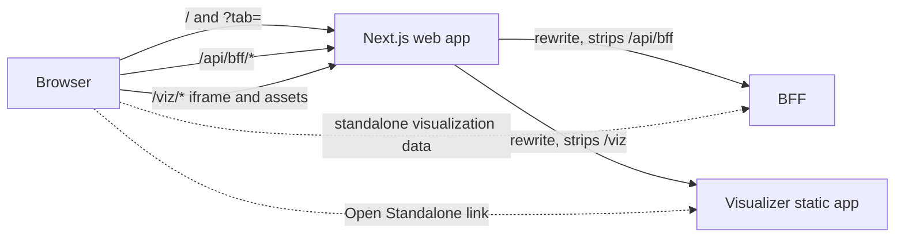

# Browser entry point and service proxy

> Status: Reviewed against HEAD 800ac16 by a fresh reader.
> Drift anchors: `apps/web/app/page.tsx`, `apps/web/src/components/system/SectionProvider.tsx`, `apps/web/src/components/system/AppShell.tsx`, `apps/web/src/components/visualizer/VisualizerEmbed.tsx`, `apps/web/src/lib/api/expresso-api.ts`, `apps/web/next.config.mjs`, `apps/web/Dockerfile`, `apps/visualizer-3d/public/index.html`, `apps/visualizer-3d/public/scene.js`, `apps/visualizer-3d/public/transport.js`, `apps/bff/src/core/session/session.service.ts`, `apps/bff/src/core/auth/auth-session.service.ts`, `infra/docker/compose.yaml`.

The browser enters the product through `/`. That page keeps four workspace sections addressable with `?tab=`, while the Next.js server proxies application API and embedded visualizer requests to their services. The standalone visualizer instead uses a browser-reachable BFF address.

## Request topology

The web server is the browser-facing boundary for `/api/bff` and `/viz` assets. Embedded visualizer data also travels through `/api/bff`, using its own transport independently of the web API client. The standalone link opens the visualizer at its separately configured browser-reachable address.

## Workspace routing

`/` is the only workspace route. `?tab=catalog`, `?tab=orders`, `?tab=performance`, and `?tab=dev` select Catalog, Orders, Performance, and API sections. Missing or unrecognized values resolve to Catalog. Section changes push a URL into browser history, so refresh, copy, and back or forward navigation preserve the selected section.

The visualizer remains mounted beside the selected section. The homepage iframe loads `/viz/index.html?embed=1`; the embed flag hides the visualizer HUD while leaving its scene behavior active. The path keeps relative scripts and styles under `/viz/`, where the web rewrite can serve them. The Open Standalone link uses the configured standalone URL when present and otherwise opens the iframe URL.

The web app and iframe share the browser origin. The parent sends the current cart selection or just-placed order to the iframe with `postMessage`, using the page origin as the target. The iframe accepts selection messages only from its parent window and the same origin, then sends a same-origin ready message so the parent can resend the current selection if initial message delivery raced iframe startup. The standalone visualizer has no parent and receives no selection message.

## API base selection and rewrites

The API client selects its base at call time. In browser code it uses `/api/bff`, which Next.js rewrites to the BFF with the proxy prefix removed. Server-side code calls the configured internal BFF address directly, with `http://localhost:3001` as its fallback. A non-empty `NEXT_PUBLIC_API_BASE_URL` overrides either choice.

Rewrite destinations are resolved when Next.js loads its configuration. A production standalone build therefore needs `BFF_INTERNAL_URL` and `VISUALIZER_INTERNAL_URL` at build time. The development server reads them when it starts. Compose supplies these values as build arguments for the production image and as runtime environment values for its development stage. Their defaults target local host ports, which supports running the web app outside Docker; Compose uses service addresses for container-to-container traffic.

The browser uses `/viz` for the embedded static app and its relative assets. The rewrite removes the prefix before forwarding to the visualizer service. `NEXT_PUBLIC_VISUALIZER_URL` controls the standalone link; it does not change the iframe proxy destination.

The visualizer transport chooses `/api/bff` when its pathname starts with `/viz`. Otherwise it uses the config shim generated from `VIZ_API_BASE_URL`, falling back to `http://localhost:3001`. Both modes use SSE with polling as a fallback.

See [configuration reference](../reference/configuration.md) for the configuration inventory and [HTTP API reference](../reference/http-api.md) for the HTTP contract.

## Session and authentication cookies

Cart sessions use the `sid` cookie, and signed-in accounts use the `auth` cookie. Both are HTTP-only, same-site lax cookies scoped to `/`. The BFF sets `Secure` from the inbound request protocol, so plain HTTP local use does not receive a cookie marked secure solely because the container runs in production mode.

For proxied calls, the browser sends same-origin cookies automatically. Next.js forwards the request cookie to the BFF and returns the BFF response, including `Set-Cookie`, to the browser. The proxy removes the `/api/bff` prefix before the BFF handles the request, so the BFF sees its normal route paths. The root cookie path also covers direct BFF clients that do not use the web proxy.

## Demo mode and service failures

Demo mode switches the web API client from live BFF requests to in-browser mock implementations. `NEXT_PUBLIC_DEMO_MODE=true` enables it at build time, and the user-facing toggle can also enable it through local storage. The toggle cannot disable a build-time setting of `true`.

This bypasses the BFF for the web application's API operations. It does not reconfigure the iframe transport, which continues requesting live scene data through `/api/bff`.

When the web server is unavailable, the browser cannot load the workspace or either same-origin proxy. If the BFF is unavailable or its rewrite target is wrong, live API requests fail; demo mode can continue using mock API data.

The iframe shows an error with a retry action on an iframe error event or after 12 seconds without a load event. Proxy HTTP failures can still fire a load event, so this indicator does not prove visualizer health. The standalone link only helps when its configured address is reachable from the browser.

A failed scene-data connection prevents live updates even when the iframe loads. The transport shows a fallback scene on an initial fetch failure and retains existing scene objects on later fetch failures.
