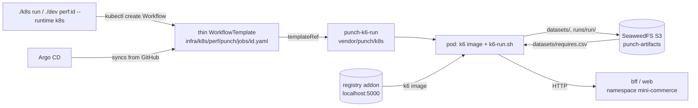

# Punch on Kubernetes — Step-by-Step Guide

Punch's k6 jobs run natively on Kubernetes as well as on Docker Compose.
Argo Workflows executes them, S3 holds datasets and evidence, an OCI registry
holds the k6 images, and Argo CD syncs everything from git. No Python and no
Punch image run in the cluster. Everything runs locally on minikube:
SeaweedFS stands in for S3 and the minikube registry addon for ECR.

This guide walks from an empty machine to a verified run, then covers
GitOps, evidence, troubleshooting, and how it works. The compose runtime
(`./dev perf:<id>`) is unchanged and stays the default.

- Design: [spec](../superpowers/specs/2026-10-13-punch-k8s-native-design.md)
- Punch's runtime contract and generic operation (consumer image, job
  mapping, runs, datasets, Argo CD, AWS, the CI design, troubleshooting):
  [`vendor/punch/k8s/README.md`](../../vendor/punch/k8s/README.md). This
  guide covers only this repository's setup on minikube.
- Open follow-ups: [`../next-steps/punch-k8s.md`](../next-steps/punch-k8s.md)

## Two ways to drive it

Both front ends apply the same manifests and use the same names. Pick one;
this guide shows `./k8s` first and the `./dev` equivalent beside it.

| Task                     | Bash + kubectl only              | Python orchestrator                           |
| ------------------------ | -------------------------------- | --------------------------------------------- |
| Start cluster + app      | `./k8s up`                       | `./dev k8s:up`                                |
| Deploy the perf platform | `./k8s perf:up`                  | `./dev k8s:perf:up`                           |
| Run one job              | `./k8s run <id> [opts]`          | `./dev perf:<id> --runtime k8s [opts]`        |
| Verify the POC           | `./k8s verify`                   | — (run the workflow by hand, step 6)          |
| Show a run's evidence    | `./k8s evidence <run>`           | — (kubectl, step 4)                           |
| Open a UI                | `./k8s ui argo\|argocd\|s3`      | — (port-forward, steps 4–5)                   |
| GitOps with Argo CD      | `./k8s argocd:up [--revision R]` | `./dev argocd:up [--revision R]`              |
| Status                   | `./k8s status`                   | `./dev k8s:status`                            |
| App on localhost         | `./k8s forward`                  | `./dev k8s:forward` (re-forwards on restarts) |
| Stop (data kept)         | `./k8s down`                     | `./dev k8s:down`                              |

`./k8s` needs only `docker`, `minikube`, and `kubectl` (it works with macOS's
bash 3.2). `./dev` additionally needs Python 3.9+ and Punch's
`requirements.txt` for `perf:*`. `./k8s help` lists every command and option.

## Step 0 — Prepare the machine

1. **Docker Desktop with at least 6 GB of memory.** Settings → Resources →
   Memory → 6 GB or more → Apply & restart. Check it:

   ```bash
   docker info --format '{{.MemTotal}}'     # ≥ 5905580032 (about 5.5 GiB)
   ```

   The cluster takes 4.5 GB: the app, Argo Workflows, Argo CD, SeaweedFS, and
   k6 pods together need it.

2. **Tools:** `brew install minikube` (it brings `kubectl`). The `argo` CLI
   is optional.

3. **The Punch submodule**, which holds the generic workflow template:

   ```bash
   git submodule update --init --recursive
   ```

4. **Only for `./dev`:** Punch's Python dependency.

   ```bash
   python3 -m pip install -r vendor/punch/requirements.txt
   ```

## Step 1 — Start the cluster and the app

```bash
./k8s up          # or: ./dev k8s:up
```

This creates the `mini-commerce` minikube profile (4.5 GB, 4 CPUs, docker
runtime) on first run, builds the app images into the cluster
(`bff`, `bff-dev`, `web`, `visualizer-3d`), applies `infra/k8s`, and waits
for the rollouts. It ends with:

```text
  ✓ stack is running in minikube — next: ./k8s perf:up
```

Later runs reuse the cluster; `--no-build` skips the image builds when only
manifests changed.

> If an older 3 GB profile exists, `up` warns. Recreating it is destructive
> (Postgres data and built images; the seed restores the data):
> `minikube delete -p mini-commerce`, then `./k8s up` again.

## Step 2 — Deploy the perf platform

```bash
./k8s perf:up     # or: ./dev k8s:perf:up
```

In order, this:

1. enables the minikube `registry` addon (the ECR stand-in at `localhost:5000`);
2. builds `infra/docker/k6.Dockerfile` and `k6-browser.Dockerfile` into the
   node and pushes them as `localhost:5000/mini-commerce/k6[-browser]:local`;
3. applies `infra/k8s/perf` server-side: Argo Workflows v4.1.5 (namespace
   `argo`), SeaweedFS (namespace `aws-local`, bucket `punch-artifacts`), and
   Punch's templates (namespace `punch`);
4. waits for the controller, the Argo server, and SeaweedFS.

It lists the templates and ends with `✓ Punch is ready`:

```text
NAME                       AGE
browser-cart               22s
browser-purchase           22s
http-auth-login            22s
http-cart                  22s
http-me-hot-status         22s
http-orders                22s
http-orders-status         22s
http-purchase              21s
http-purchase-registered   21s
punch-k6-run               21s
```

`punch-k6-run` is the generic step; the other nine map one-to-one to
`tests/performance/k6/jobs/*.yaml`.

## Step 3 — Run your first job

```bash
./k8s run http-purchase --config 1-iteration
# or: ./dev perf:http-purchase --runtime k8s --config 1-iteration
```

The command submits an Argo Workflow, streams k6's output, and ends with the
result:

```text
Punch on Kubernetes — http-purchase (Argo Workflows)

  → Config  : 1-iteration
  → Submitted http-purchase-swhxt
   ✓ checks.........................: 100.00% ✓ 11       ✗ 0
   ✓ http_req_failed................: 0.00%   ✓ 0        ✗ 6
  ✓ k6 http-purchase completed on k8s (http-purchase-swhxt)
  → Evidence: ./k8s evidence http-purchase-swhxt
```

The exit code is 0 on success and 1 on failure. Ctrl+C stops the run.

Options (same for `./k8s run` and `./dev perf:<id> --runtime k8s`):

| Option                | Meaning                                                                                                                                                                                                                                    |
| --------------------- | ------------------------------------------------------------------------------------------------------------------------------------------------------------------------------------------------------------------------------------------ |
| `--config <preset>`   | k6 load shape from `tests/performance/k6/options/`: `1-iteration`, `5-iterations`, `1-vu-5m`, `5-vu-5m`, and the `-browser` variants. A name, not a path. Default: the job's own (`5-iterations`; `5-iterations-browser` for `browser-*`). |
| `--produce <dataset>` | Publish the run's `[DATA]` rows to `s3://punch-artifacts/datasets/<dataset>.csv` (repeatable, or `all`).                                                                                                                                   |
| `--base-url <url>`    | Target inside the cluster. Default: `http://bff.mini-commerce.svc.cluster.local:3001` (`http-*`) or the `web` Service (`browser-*`).                                                                                                       |

Job-specific settings that compose forwards from your shell are
forwarded the same way, e.g. `EXPECT_TEMPERATURE=hot ./k8s run http-orders-status`.
Values cannot contain spaces.

## Step 4 — Look at the evidence

Every run leaves three kinds of evidence: the Workflow's status, its archived
log, and its reports in S3.

```bash
./k8s evidence http-purchase-swhxt
```

```text
Evidence — http-purchase-swhxt

  phase      Succeeded
  started    2026-10-13T22:45:38Z
  finished   2026-10-13T22:45:49Z
  arguments  config=1-iteration
  steps      k6:Succeeded:exit=0
  datasets
  message

  → s3://punch-artifacts/runs/http-purchase-swhxt/
    runs/http-purchase-swhxt/http-purchase-swhxt-k6-3916631289/main.log
    runs/http-purchase-swhxt/reports/http-purchase-report.html
    runs/http-purchase-swhxt/reports/http-purchase-summary.json

  → summary (http-purchase-summary.json)
    { "testType": "http-purchase", "totalRequests": 6, "errorRate": 0,
      "p90Ms": 18.4, "checkPassRate": 1, "passed": true, ... }
```

The bucket layout:

```text
s3://punch-artifacts/
  datasets/<dataset>.csv   published by --produce; read by the next run's preflight
  runs/<run>/              archived pod log and reports/ (summary JSON + HTML)
```

To read the HTML report, open the S3 file browser:

```bash
./k8s ui s3       # opens http://localhost:8888/buckets/punch-artifacts/
```

and follow `runs/<run>/reports/`. For ad-hoc queries, `./k8s s3` runs
aws-cli against the bucket, e.g. `./k8s s3 s3 ls s3://punch-artifacts --recursive`.

Without `./k8s`, run the queries in Punch's
[Follow a run and read its evidence](../../vendor/punch/k8s/README.md#follow-a-run-and-read-its-evidence)
with `--context mini-commerce -n punch`.

## Step 5 — Watch runs in the Argo UI

```bash
./k8s ui argo     # opens https://localhost:2746/workflows/punch
```

Accept the self-signed certificate; no login is needed. Each run shows its
step graph; click the `k6` step for **Logs**, **Inputs/Outputs** (parameters
and the `datasets` row count), and **Artifacts**. Ctrl+C in the terminal stops
the port-forward.

## Step 6 — Hand data between jobs

Jobs pass data through S3 datasets: a producer publishes rows, a
consumer reads them. The cart → orders → status workflow:

```bash
./k8s run http-orders                         # 1. no carts yet: stops before k6
./k8s run http-cart --produce carts           # 2. publishes carts
./k8s run http-orders --produce orders        # 3. reads carts, publishes orders
./k8s run http-orders-status                  # 4. reads orders
```

What each run prints:

```text
1  [punch] http-orders requires "carts"; produce it with: browser-cart, http-cart (--produce carts)
   ✗ k6 http-orders failed on k8s (http-orders-2lw6d): Failed
2  ✓ k6 http-cart completed on k8s (http-cart-gfh2t).
   → Published 5 carts rows to s3://punch-artifacts/datasets/carts.csv
3  ✓ k6 http-orders completed on k8s (http-orders-qmdq8).
   → Published 5 orders rows to s3://punch-artifacts/datasets/orders.csv
4  ✓ k6 http-orders-status completed on k8s (http-orders-status-bwf96).
```

Publishing is opt-in and all-or-nothing, a consumer with no rows stops in
preflight, and a job on k8s reads at most one required dataset. Punch
owns these rules:
[Behavior](../../vendor/punch/k8s/README.md#behavior) and
[Run a Punch workflow through datasets](../../vendor/punch/k8s/README.md#run-a-punch-workflow-through-datasets).
Here the k8s datasets live in `s3://punch-artifacts/datasets/`, and the
compose runtime's stay in `tests/performance/k6/data/`.

| Dataset        | Producers                                          | Consumer             |
| -------------- | -------------------------------------------------- | -------------------- |
| `carts`        | `http-cart`, `browser-cart`                        | `http-orders`        |
| `orders`       | `http-orders`, `http-purchase`, `browser-purchase` | `http-orders-status` |
| `owned-orders` | `http-purchase-registered`                         | (not wired on k8s)   |
| `auth-tokens`  | `http-auth-login`                                  | `http-me-hot-status` |

## Step 7 — Verify the POC in one command

```bash
./k8s verify
```

It resets `s3://punch-artifacts/datasets/` and checks every guarantee in
order, failing with a non-zero exit if any step deviates:

```text
1/7 Clean datasets
  ✓ datasets cleared
2/7 A consumer with no data stops before k6
  ✓ http-orders requires "carts"; produce it with: browser-cart, http-cart (--produce carts)
3/7 Producer publishes carts
  ✓ Published 5 carts rows
4/7 Consumer reads carts and publishes orders
  ✓ Published 5 orders rows
5/7 Last link reads orders
  ✓ http-orders-status completed
6/7 A failed producer leaves the previous dataset untouched
  ✓ carts.csv ETag unchanged ("4193c519c621d669cfe7549683acce36")
7/7 Evidence
    carts.csv, orders.csv, and the five run names

  ✓ POC verified: all 7 steps passed
```

## Step 8 — GitOps with Argo CD

Argo CD keeps the perf platform and the app in sync with GitHub and runs
`http-purchase` (`1-iteration`) after every sync of the app. A failed smoke
fails the sync.

1. Make sure the k6 images are in the registry (step 2): Argo CD syncs
   manifests only.
2. Push the commit you want to deploy. Argo CD reads GitHub, not your
   working tree.
3. Install and sync:

   ```bash
   ./k8s argocd:up --revision main     # or: ./dev argocd:up --revision main
   ```

   ```text
     ✓ Argo CD is running
     ✓ punch-platform: synced and healthy
     ✓ mini-commerce: synced and healthy
     ✓ punch-platform and mini-commerce are synced; the PostSync smoke passed
   ```

   It creates `punch-platform` (`infra/k8s/perf`) first and waits until it
   is healthy, then `mini-commerce` (`infra/argocd/mini-commerce`: the app plus
   the smoke). Re-running it asks for a fresh sync and waits for that one, so
   it never reports an older result.

4. Open the UI:

   ```bash
   ./k8s ui argocd   # prints the admin password, opens https://localhost:8080
   ```

   Log in as `admin`. The smoke run appears as `postsync-smoke` in the
   `punch` namespace (Argo UI) after each sync.

Sync policy is automated without self-heal or prune, so `./k8s up` rollout
restarts don't fight Argo CD. To deploy another branch, push it and run
`./k8s argocd:up --revision <branch>`. To re-sync one app by hand:

```bash
kubectl --context mini-commerce -n argocd patch application mini-commerce --type merge \
  -p '{"operation":{"initiatedBy":{"username":"me"},"sync":{"revision":"main"}}}'
```

## Step 9 — Stop or reset

```bash
./k8s down                          # stop; images, Postgres data and S3 datasets are kept
./k8s up && ./k8s perf:up           # start again later (add --no-build to skip image builds)
minikube delete -p mini-commerce    # remove everything (destructive)
```

## How it works



Punch owns the generic step `punch-k6-run`, its shell step `k6-run.sh`, the
artifact layout, and the evidence: see the
[Punch runtime contract](../../vendor/punch/k8s/README.md). This repository
supplies the nine thin templates in `infra/k8s/perf/punch/jobs/`, one
per job YAML in `tests/performance/k6/jobs/`, built by Punch's
[mapping](../../vendor/punch/k8s/README.md#from-a-job-yaml-to-a-thin-template).
`scripts/pg/tests/test_k8s_jobs.py` fails CI when a thin template drifts
from its job YAML. The artifact repository is the
`artifact-repositories` ConfigMap in namespace `punch`
(`infra/k8s/perf/punch/artifact-repositories.yaml`).

| Namespace       | Holds                                                                                  |
| --------------- | -------------------------------------------------------------------------------------- |
| `mini-commerce` | The app (`infra/k8s`)                                                                  |
| `argo`          | Argo Workflows v4.1.5 controller + UI (`--auth-mode=server`, minimal CRDs)             |
| `punch`         | `punch-k6-run`, nine thin templates, runs, presets, artifact repository, executor RBAC |
| `aws-local`     | SeaweedFS 4.48 — S3 stand-in, bucket `punch-artifacts`                                 |
| `kube-system`   | minikube `registry` addon — ECR stand-in at `localhost:5000`                           |
| `argocd`        | Argo CD v3.5.5 (dex, notifications, ApplicationSet scaled to 0)                        |

| Path                                  | Holds                                                |
| ------------------------------------- | ---------------------------------------------------- |
| `k8s`                                 | The bash + kubectl front end                         |
| `infra/k8s/perf/`                     | Perf platform kustomization (Argo, SeaweedFS, Punch) |
| `infra/argocd/install/`               | Argo CD install                                      |
| `infra/argocd/applications/`          | `punch-platform` and `mini-commerce` Applications    |
| `infra/argocd/mini-commerce/`         | The app overlay plus the PostSync smoke              |
| `vendor/punch/k8s/`                   | Punch's generic template, shell step, RBAC           |
| `scripts/pg/k8s_perf.py`, `argocd.py` | The `./dev` implementations                          |

## Doing it with kubectl only

Every step has a plain kubectl equivalent.

```bash
# Perf platform (repeat once if the first pass reports "no matches for kind WorkflowTemplate")
kubectl kustomize --load-restrictor LoadRestrictionsNone infra/k8s/perf \
  | kubectl --context mini-commerce apply --server-side --force-conflicts -f -
```

For one run, create a Workflow as in Punch's
[Run a job](../../vendor/punch/k8s/README.md#run-a-job), with
`--context mini-commerce -n punch` in place of `-n perf`.

The images must exist first: `minikube -p mini-commerce addons enable registry`,
then build `infra/docker/k6.Dockerfile` and `k6-browser.Dockerfile` after
`eval "$(minikube -p mini-commerce docker-env)"`, tag them
`localhost:5000/mini-commerce/k6:local` / `…/k6-browser:local`, and
`docker push`. For Argo CD: apply the rendered `infra/argocd/install`
server-side, then `kubectl apply -f` each file in `infra/argocd/applications/`
after editing its `targetRevision`.

## Porting to AWS

Punch's [Run on AWS](../../vendor/punch/k8s/README.md#run-on-aws) lists the
three pieces that change, and
[Trigger from CI](../../vendor/punch/k8s/README.md#trigger-from-ci) holds the
on-demand job design. In this repository those pieces are the k6 images
(`localhost:5000/mini-commerce/k6[-browser]:local` today), the SeaweedFS
repository in `infra/k8s/perf/punch/artifact-repositories.yaml`, and the
Argo server's `--auth-mode=server` patch in
`infra/k8s/perf/argo-workflows/kustomization.yaml`. The job is an open
follow-up: [`../next-steps/punch-k8s.md`](../next-steps/punch-k8s.md).

## Troubleshooting

Errors from the step itself (preflight, `[DATA]` harvest, invalid
parameters, k6 exit 99) and the CRD race on apply are in Punch's
[Troubleshooting](../../vendor/punch/k8s/README.md#troubleshooting). This
table covers this repository's CLIs and cluster.

| Symptom                                                     | Cause and fix                                                                                                    |
| ----------------------------------------------------------- | ---------------------------------------------------------------------------------------------------------------- |
| `cluster 'mini-commerce' is not running`                    | `./k8s up`.                                                                                                      |
| `no job '<id>' in namespace punch`                          | The perf platform isn't deployed: `./k8s perf:up`.                                                               |
| `<run> cannot start yet — ImagePullBackOff`                 | The k6 images aren't in the registry: `./k8s perf:up` without `--no-build`. The run fails after 900 s otherwise. |
| `--config takes a preset name` / `unknown preset`           | On k8s, `--config` takes a name from `tests/performance/k6/options/`, not a path.                                |
| `<NAME> contains whitespace, which k8s runs cannot forward` | `./k8s run` and `./dev perf:<id> --runtime k8s` forward a shell variable only when its value has no spaces.      |
| API timeouts, controllers restarting, pods evicted          | Memory pressure. Check `./k8s status`; Docker needs ≥ 6 GB and the cluster 4.5 GB.                               |
| Argo CD app shows `Unknown` sync                            | It tracks a branch that no longer exists: `./k8s argocd:up --revision main`.                                     |
| `mini-commerce` shows OutOfSync but Healthy                 | Benign: the `postgres` StatefulSet and the hook Workflow differ in server-filled fields.                         |
| Argo CD sync failed on `postsync-smoke`                     | The smoke failed; open it in the Argo UI (`punch` namespace), fix, push, and re-run `./k8s argocd:up`.           |
